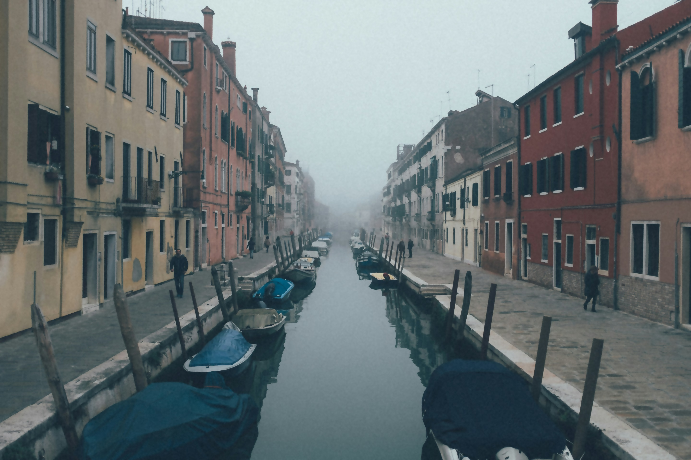
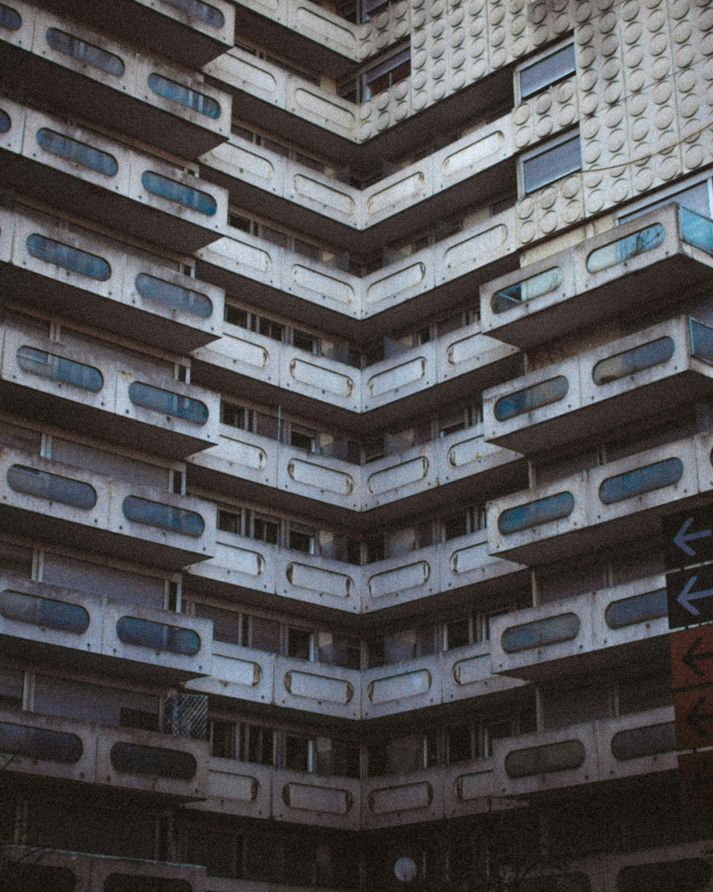
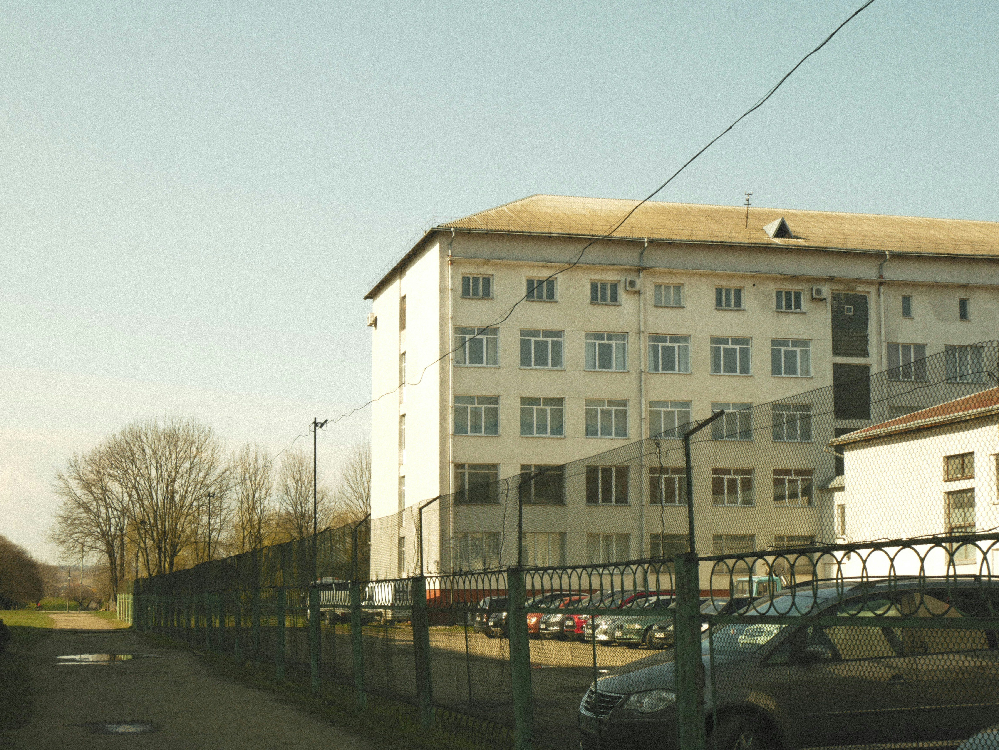

# Image Denoiser Project

A modular C++17 image-denoising **library** and **CLI**. Five denoising algorithms
from four different mathematical families sit behind one abstract interface, are
instantiated through a registry-based factory, and are driven either
non-interactively (batch) or through a menu-driven interactive session.

The point of the project is architectural rather than "one more filter": a single
`ImageDenoiser` interface, stateless `const` implementations that are safe to share
across threads, and a front end that can run every algorithm on one image and show
you the results side by side.

---

## Example Outputs

<h4 align="center">Original Image vs Denoised Image using Bilateral Filter</h4>

 

<h4 align="center">Original Image vs Denoised Image using Total Variation Filter</h4>

 

<h4 align="center">Original Image vs Denoised Image using Discrete Cosine Transform Filter</h4>

 

---

## Highlights

- **One interface, five algorithms** — `ImageDenoiser` with a pure virtual
  `denoise() const`; filters are stateless value objects with no resources of their own.
- **No manual memory management** — zero raw `new`/`delete` in the codebase; images are
  reference-counted `cv::Mat`, polymorphic filters are `std::unique_ptr`.
- **Race-free by construction** — `denoise()` is `const`, so no implementation can cache
  per-image state. All shared inputs are read-only; every filter works on a private
  `[0, 1]` float copy.
- **In-place safe** — `denoise(img, img, params)` is explicitly supported and covered
  by tests, for every filter.
- **Everything validated** — parameters and images are checked up front and reported as
  typed exceptions (`InvalidParameterError`, `UnknownDenoiserError`), never as an
  assertion or a crash.
- **Strict build** — `-Wall -Wextra -Wpedantic -Werror`, C++17, target-based CMake,
  no build warnings.

---

## Architecture

```
                         ┌──────────────────────────────────────┐
                         │          ImageDenoiser (ABC)         │
                         │  denoise(in, out, params) const = 0  │
                         │  denoise(..., onProgress) const      │
                         │  name() / description() const = 0    │
                         │  ~ImageDenoiser() virtual            │
                         └──────────────────┬───────────────────┘
                                            │ public inheritance
        ┌────────────────┬──────────────────┼──────────────────┬─────────────────┐
        │                │                  │                  │                 │
┌───────────────┐ ┌──────────────┐ ┌───────────────┐ ┌──────────────────┐ ┌───────────────┐
│ Bilateral     │ │ NonLocalMeans│ │ DctFilter     │ │ AnisotropicDiff. │ │ TotalVariation│
│ (spatial)     │ │ (patch-based)│ │ (frequency)   │ │ (PDE)            │ │ (variational) │
└───────────────┘ └──────────────┘ └───────────────┘ └──────────────────┘ └───────────────┘
        ▲                ▲                  ▲                  ▲                 ▲
        └────────────────┴──────────────────┴──────────────────┴─────────────────┘
                               DenoiserFactory (registry)
                                            │ std::unique_ptr<ImageDenoiser>
                          ┌─────────────────┴──────────────────┐
                          │      CLI front end (src/)          │
                          │ batch │ --method all │ interactive │
                          └────────────────────────────────────┘
```

**Layers, strictly separated**

| Layer | Files | Responsibility |
|---|---|---|
| Interface | `include/denoiser/ImageDenoiser.hpp` | `DenoiseParams` + abstract base class. No I/O, no CLI. |
| Algorithms | `src/*Filter.cpp` | Pure numerics on `cv::Mat`. They know nothing about files, prompts or benchmarks. |
| Factory | `src/DenoiserFactory.cpp` | Identifier → `unique_ptr<ImageDenoiser>`. Extensible at runtime. |
| Internal helpers | `src/detail/ImageUtils.hpp` | Depth conversion and padding. Not installed, not public API. |
| CLI | `src/main.cpp`, `src/CliCommon.hpp`, `src/ConcurrentRunner.hpp` | Argument parsing, batch runs, concurrent suite. |
| Interactive UI | `src/InteractiveSession.{hpp,cpp}` | Menu loop, prompting, defaults. |

The library never includes a CLI header, and the CLI never reaches into algorithm
internals. `src/detail/` and the CLI headers are deliberately excluded from the
installed headers.

### Adding an algorithm

Two options, both without touching existing code:

```cpp
// 1. Register your own type (runtime, no factory changes needed)
class MyFilter final : public denoiser::ImageDenoiser {
public:
    void denoise(const cv::Mat& in, cv::Mat& out,
                 const denoiser::DenoiseParams& p) const override;  // no state
    std::string name() const override { return "mine"; }
    std::string description() const override { return "My filter."; }
};

denoiser::DenoiserFactory::registerDenoiser<MyFilter>("mine");
```

```cpp
// 2. Or add a built-in: a header, a source file, one emplace() in DenoiserFactory.cpp
//    and one line in CMakeLists.txt.
```

`--list`, the interactive menu and `--method all` pick up registered filters
automatically — nothing else needs to change. The only three-argument
`denoise()` overload is enough; progress reporting is optional via the base class.

---

## Algorithms

| Filter | Identifier | Family | Cost per pixel | Primary parameters |
|---|---|---|---|---|
| `BilateralFilter` | `bilateral` | Spatial, edge-aware | `O(k² · C)`, `k = 2⌈2σs⌉+1` | `spatialSigma`, `intensitySigma` |
| `NonLocalMeansFilter` | `nlm` | Patch self-similarity | `O(S² · P² · C)` | `intensitySigma` (h), `searchWindow`, `patchSize` |
| `DctFilter` | `dct` | Frequency (transform + shrinkage) | `O(C · B² log B)` per block, 50% overlap | `blockSize`, `threshold` |
| `AnisotropicDiffusionFilter` | `anisotropic` | PDE (Perona–Malik) | `O(T · C)` | `num_iterations`, `time_step`, `conduction_coefficient` |
| `TotalVariationFilter` | `tv` | Convex optimization (ROF, Chambolle dual) | `O(T · C)` | `lambda`, `num_iterations`, `time_step` |

References: Tomasi & Manduchi (ICCV 1998); Buades, Coll & Morel (CVPR 2005);
Yu & Sapiro (2011) ; Perona & Malik (TPAMI 1990);
Rudin, Osher & Fatemi (1992) with Chambolle's dual projection (2004).

All filters share these conventions:

- 8-bit and 16-bit inputs are converted to `CV_32F` scaled into `[0, 1]`; parameters
  are therefore depth-independent (`intensitySigma = 0.1` means the same thing for
  8-bit and 16-bit data).
- Borders are handled once, up front: `BORDER_REFLECT_101` padding (bilateral, NLM),
  a replicated ring held fixed across time steps (anisotropic), or an
  adjoint-consistent forward/backward difference pair (TV). No per-pixel boundary
  branches in the hot loops.
- Numerical stability is enforced, not assumed: `time_step ∈ (0, 0.25]` for the
  explicit schemes, `blockSize ∈ [1, 64]` and rounded down to even for the DCT.

---

## Building

**Requirements**

- CMake ≥ 3.16
- A C++17 compiler (tested with GCC 15.1/13, MinGW-w64 and MSVC 2019+)
- OpenCV ≥ 4.0 with `core`, `imgproc`, `imgcodecs`
- Optional: OpenMP (enables the parallel filtering loops automatically)
- Optional: binutils `objdump` — lets the Windows runtime bundler resolve
  exactly which DLLs are needed; without it, every DLL in the located
  toolchain directories is copied instead

```bash
cmake -S . -B build -DCMAKE_BUILD_TYPE=Release
cmake --build build -j
ctest --test-dir build --output-on-failure
```

Binaries land in `build/`: `denoiser-cli` (or `denoiser-cli.exe`).

**CMake options**

| Option | Default | Effect |
|---|---|---|
| `DENOISER_BUILD_TESTS` | `ON` | Builds and registers the test suite with CTest. |
| `DENOISER_ENABLE_SANITIZERS` | `OFF` | Adds `-fsanitize=address,undefined` (GCC/Clang). Fails fast if the toolchain cannot link the sanitizer runtime. |
| `DENOISER_BUNDLE_RUNTIME` | `ON` (Windows) | Bundles the required OpenCV/compiler runtime DLLs next to the executables so they run without `PATH` setup (objdump import-table scan, bulk-copy fallback). |

`-O3` is applied to `Release` builds only, so `Debug` and `RelWithDebInfo` stay
debuggable and ASan stack traces stay readable.

<details>
<summary>Windows / MSYS2 notes</summary>

The `CMakeLists.txt` auto-detects MSYS2/MinGW OpenCV in two steps and appends it
to `CMAKE_PREFIX_PATH`: first the MSYS2 environment of the configured compiler
itself (any install root — `C:/msys64`, `D:/msys64`, `C:/mingw64`, ...), then
the standard `C:/msys64` environments (`mingw64`, `ucrt64`, `clang64`,
`clangarm64`). A plain `cmake -S . -B build` therefore works from CLion or a
plain shell. For any other OpenCV location, pass `-DOpenCV_DIR=...` or
`-DCMAKE_PREFIX_PATH=...` — paths passed explicitly always take precedence.
The post-build step resolves every transitive DLL dependency of the
executables with binutils' `objdump` and copies it next to the binary;
without `objdump` it falls back to copying every DLL from the toolchain's
runtime directories.
</details>

---

## Usage

### Single filter (batch)

```bash
denoiser-cli -i photo.png -f nlm -o photo_denoised.png
denoiser-cli -i photo.png -f tv --lambda 0.15 --num-iterations 100 -o photo_tv.png
denoiser-cli -i photo.png -f bilateral --spatial-sigma 4 --intensity-sigma 0.08
```

```
[denoiser] input   : photo.png (4059x2706, 3 channel(s), 8-bit)
[denoiser] filter  : bilateral
[denoiser] output  : photo_denoised.png
```

### Every filter on one image

```bash
denoiser-cli -i photo.png --method all
```

Each filter runs in its own `std::async` task on its own `unique_ptr` instance and
writes `output/<name>_<filter>.<ext>`:

```
================================================================
Image Denoising Results
================================================================
Method                 | Output
----------------------------------------------------------------
AnisotropicDiffusion   | output\photo_anisotropic.jpg
BilateralFilter        | output\photo_bilateral.jpg
DctFilter              | output\photo_dct.jpg
NonLocalMeansFilter    | output\photo_nlm.jpg
TotalVariationFilter   | output\photo_tv.jpg
================================================================
```

A single method that throws is reported as `failed` with its diagnostic, and the
other results are still written — one broken filter never discards the rest.

### Interactive session

```bash
denoiser-cli            # no arguments: opens the menu
denoiser-cli -I
```

Asks for a path, an optional synthetic noise level, presents the registry, prompts
only for the parameters the chosen filter actually uses (Enter accepts the shown
default), runs it, then offers *run again / new image / quit*. Non-numeric and
out-of-range input re-prompts; a closed stdin (`Ctrl+D`, `Ctrl+Z`, piped input
running out) ends the session cleanly instead of spinning.

### Everything else

```bash
denoiser-cli --list                    # registered filters + descriptions
denoiser-cli --help                    # full option reference
denoiser-cli -i photo.png --noise 12   # add Gaussian noise first, then denoise
```

### Parameter reference

| CLI option | Field | Default | Used by / constraint |
|---|---|---|---|
| `--spatial-sigma` | `spatialSigma` | `3.0` | Bilateral kernel; `> 0`, `≤ 100` |
| `--intensity-sigma` | `intensitySigma` | `0.1` | Range sigma (bilateral) / h (NLM) / noise sigma (DCT); `> 0` |
| `--search-window` | `searchWindow` | `21` | NLM; positive odd integer |
| `--patch-size` | `patchSize` | `7` | NLM; positive odd integer |
| `--block-size` | `blockSize` | `8` | DCT; `1..64`, clamped to image and rounded down to even |
| `--threshold` | `threshold` | `2.7` | DCT; `τ = threshold × intensitySigma`, `≥ 0` |
| `--num-iterations` | `num_iterations` | `30` | PDE time steps / TV projection steps; `1..500` |
| `--time-step` | `time_step` | `0.15` | Explicit step `dt` / TV `τ`; `(0, 0.25]` |
| `--conduction-coefficient` | `conduction_coefficient` | `0.15` | Perona–Malik `k`; `> 0` |
| `--lambda` | `lambda` | `0.1` | TV weight; `> 0` |
| `--iterations` | `iterations` | `1` | Outer passes, all filters; `≥ 1` |
| `--noise` | — | `0` | CLI only: synthetic Gaussian noise, native intensity units |

---


## Testing and memory safety

```bash
ctest --test-dir build --output-on-failure
```

`tests/DenoiserTests.cpp` is a single, dependency-free runner (no GTest) — 209
assertions in 13 sections covering:

- factory: create/identify/reject, case-insensitive lookup, enum ↔ string round-trip,
  unknown identifiers, custom registration and duplicate rejection;
- validation: every documented parameter bound, empty images, unsupported depths;
- per-filter numerics: geometry, depth/channels preserved, no `NaN`/`Inf`, noise
  actually reduced, output written to a private buffer;
- **in-place aliasing** (`denoise(img, img, ...)` equals the out-of-place result);
- **degenerate geometry**: 1×1, 2×2, 3×5, 5×3, 1×17, 17×1 — either filtered
  correctly or rejected with a catchable error, never a crash;
- **progress contract**: fractions within `[0, 1]`, finishing at exactly 1.0, and a
  regression test that bilateral reports per *row*, not per pixel;
- **thread safety**: one shared `const` instance called from six threads reproduces
  the serial result bit-for-bit.

Sanitizers:

```bash
cmake -S . -B build-asan -DCMAKE_BUILD_TYPE=Debug -DDENOISER_ENABLE_SANITIZERS=ON
cmake --build build-asan -j && ctest --test-dir build-asan --output-on-failure
```

```bash
valgrind --leak-check=full --error-exitcode=1 ./build/denoiser_tests
```

The library holds no OS resources, allocates only through `cv::Mat` and
`std::make_unique`, and its only static state is the factory registry (initialized
once, thread-safely). Note that the MinGW-w64 toolchain used for the Windows build
ships without `libasan`/`libubsan`, so the sanitizer build must be run on
Linux/macOS/Clang; the CMake option detects this and says so instead of failing in
the linker.

---

## Project layout

```
include/denoiser/          Public API (installed)
  ImageDenoiser.hpp          DenoiseParams + abstract base
  DenoiserFactory.hpp        Registry-based factory
  Error.hpp                  DenoiserError hierarchy
  *Filter.hpp                One header per algorithm
src/
  ImageDenoiser.cpp          Parameter/input validation
  DenoiserFactory.cpp        Built-in registration
  *Filter.cpp                Algorithm implementations
  detail/ImageUtils.hpp      Internal: depth conversion, padding (not installed)
  main.cpp                   Argument parsing + batch pipeline
  CliCommon.hpp              Shared CLI helpers (progress, image description)
  ConcurrentRunner.hpp       --method all: std::async suite + results table
  InteractiveSession.{hpp,cpp}
tests/DenoiserTests.cpp      Self-contained test runner
cmake/FixupRuntime.cmake     Windows DLL bundling
```

---

## Design notes

- **`denoise()` is `const`.** This is the load-bearing decision for thread safety: an
  implementation physically cannot stash per-image state in the object, so the
  compiler — not a comment — guarantees that concurrent calls cannot race on `this`.
- **`cv::Mat` copies are shallow; mutation is not.** Passing a `cv::Mat` across
  threads copies a reference-counted header while pixels stay shared and read-only.
  Every filter immediately converts to its own `[0, 1]` float buffer
  (`convertTo` allocates), so no worker ever writes to shared memory.
- **Filters are copy/move-deleted, not just polymorphic.** `ImageDenoiser` deletes
  copy and move to prevent slicing; ownership is always `unique_ptr`.
- **No self-registering statics.** Built-ins are registered explicitly in
  `DenoiserFactory.cpp`; relying on translation-unit static initializers silently
  breaks with static libraries when the linker drops unreferenced objects.
- **Failures stay local.** `--method all` catches per task, so a single bad filter
  degrades one row of the table instead of aborting the suite.
- **Exceptions never cross an OpenMP region.** The DCT filter captures worker
  exceptions and rethrows them on the calling thread, because an escaping exception
  inside a parallel region calls `std::terminate`.


## Author

**Lion Abramov**  
GitHub: [Lion-sudo](https://github.com/Lion-sudo)

---

## License

This project is licensed under the **MIT License** — see the [LICENSE](LICENSE) file for details.  